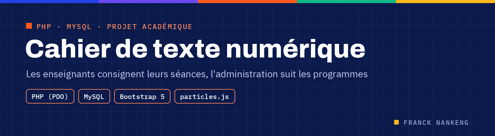

  
  
  
  

# Cahier de texte numérique pour enseignants · PHP / MySQL

**Franck Nankeng** · Projet académique · [LinkedIn](https://www.linkedin.com/in/franck-nankeng-51b43b297/)

Application web qui remplace le cahier de texte papier d'un établissement : chaque enseignant consigne ses séances,
et l'administration suit les cours effectués dans chaque classe.

## Fonctionnalités
**Enseignants**
- Saisir une séance : date, horaire, titre et contenu du cours.
- Consulter l'historique de ses cours et le détail de chaque séance.
- Gérer son profil.

**Administrateurs**
- Créer les comptes enseignants (nom, e-mail, téléphone).
- Visualiser l'ensemble des cours effectués, triés par classe, pour suivre la progression des programmes.

## Stack
PHP (PDO), MySQL, HTML/CSS, Bootstrap 5, particles.js.

## Lancer le projet en local
1. Copier le dossier `cahier_de_texte-main/` dans le répertoire web d'un serveur local (XAMPP, WAMP ou MAMP).
2. Créer la base de données MySQL et adapter les identifiants dans `config/connexion.php`.
3. Ouvrir `http://localhost/cahier_de_texte-main/`.

> Les identifiants de `config/connexion.php` sont ceux d'un environnement local de développement :
> à remplacer par des variables d'environnement avant tout déploiement.

---
*English — PHP/MySQL web app replacing a paper class logbook: teachers record each session; administrators create teacher accounts and review all sessions by class.*

---

### Autres projets

| [**Groupe Orvane**](https://github.com/Nganou1/orvane-powerbi) | [**Horizon_Contrat**](https://github.com/Nganou1/horizon-contrat-excel) | [**Process mining achats**](https://github.com/Nganou1/process-mining-achats) | [**Projets IA & ML**](https://github.com/Nganou1/projets-ia) |
|---|---|---|---|
| Power BI · 143 mesures DAX · RLS | Excel expert · Power Pivot · VBA | Python · PM4Py · audit SI | Python · machine learning · deep learning |

[Tous mes dépôts](https://github.com/Nganou1?tab=repositories) · [LinkedIn](https://www.linkedin.com/in/franck-nankeng-51b43b297/)
